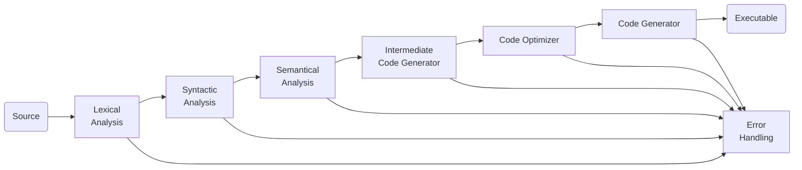

A compiler is a program that transforms a program written in the source language - taken as input - and produces a file in a different language. Usually, it's a binary file that can be executed by the machine, but it doesn't need to.

There are many types of language processors:

- **Transpilers** convert between high-level languages. For example, from JavaScript to Python.
- **Compilers** convert from a high-level language to a low-level language. For example, from C to machine language.
- **Decompiler** convert from executables to high-level languages.

## Compiler Phases

Generically, the compilation process can be divided into two major steps: **analysis** and **synthesis**. Analysis takes the source code, easily readable by a human, as input and creates an intermediate representation of that source code. Synthesis takes that representation and transforms it into the final target program.

### Lexical Analysis

TODO

### Syntactic Analysis

TODO

### Semantic Analysis

TODO

## References

- https://www.tutorialspoint.com/compiler_design/compiler_design_phases_of_compiler.htm
- https://www.geeksforgeeks.org/phases-of-a-compiler/
- https://efxa.org/2014/05/17/techniques-for-resolving-common-grammar-conflicts-in-parsers/
- https://compiladores-novenoa.blogspot.com/2011/11/fases-de-un-compilador.html
- https://www.gnu.org/software/bison/manual/html_node/Shift_002fReduce.html