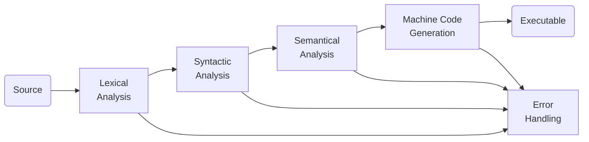

- https://efxa.org/2014/05/17/techniques-for-resolving-common-grammar-conflicts-in-parsers/
- https://compiladores-novenoa.blogspot.com/2011/11/fases-de-un-compilador.html
- https://www.gnu.org/software/bison/manual/html_node/Shift_002fReduce.html