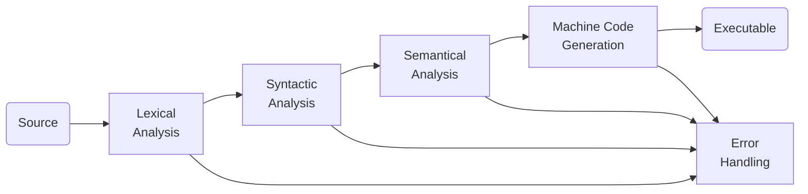

A compiler is a program that transforms a program written in the source language - taken as input - and produces a file in a different language. Usually, it's a binary file that can be executed by the machine, but it doesn't need to.

There are many types of compilers:

- **Transpilers** convert between high-level languages. For example, from JavaScript to Python.
- **Compilers**

There are various types of language processors: translators (between two high-level languages), compilers (from a high-level language to a low-level language), decompilers (from low- to high-level languages), rewriters (within the same language).

A compiler is generically divided into 

**Lexical Analysis** is TODO

**Syntactic Analysis** is TODO

**Semantical Analysis** is TODO

## References

- https://www.tutorialspoint.com/compiler_design/compiler_design_phases_of_compiler.htm
- https://www.geeksforgeeks.org/phases-of-a-compiler/
- https://efxa.org/2014/05/17/techniques-for-resolving-common-grammar-conflicts-in-parsers/
- https://compiladores-novenoa.blogspot.com/2011/11/fases-de-un-compilador.html
- https://www.gnu.org/software/bison/manual/html_node/Shift_002fReduce.html