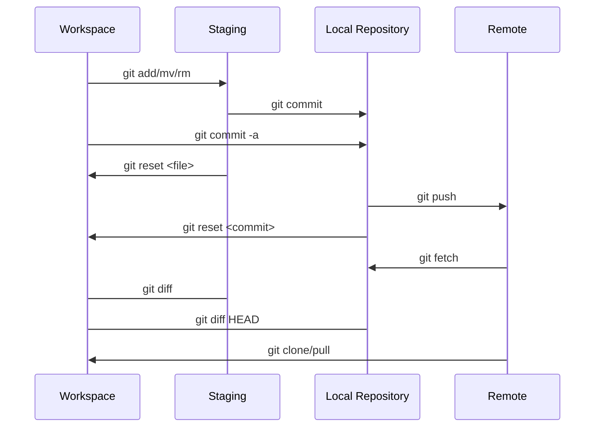

Git is a distributed version control system for tracking changes in source code during software development.



## Stage

```bash
$

```

## Branching

More on [git branching](https://git-scm.com/book/en/v2/Git-Branching-Basic-Branching-and-Merging).

### Create

```bash
# Create a new branch
$ git branch <branch-name>

# Checkout the new branch
$ git checkout <branch-name>

# Create and checkout a new branch
$ git checkout -b <branch-name>
```

### Merge

More on [branch merging](https://git-scm.com/book/en/v2/Git-Branching-Basic-Branching-and-Merging).

```bash
# Checkout master
$ git checkout master

# Merge hotfix into master
$ git merge hotfix
```

### Delete

```bash
$ git branch -d <branch-name>
```