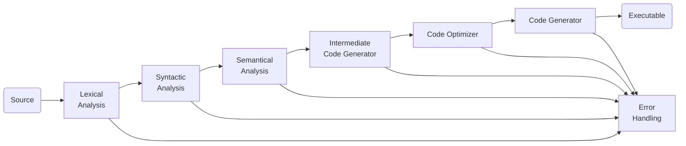

A compiler is a program that transforms a program written in the source language - taken as input - and produces a file in a different language. Usually, it's a binary file that can be executed by the machine, but it doesn't need to.

There are many types of language processors:

- **Transpilers** convert between high-level languages. For example, from JavaScript to Python.
- **Compilers** convert from a high-level language to a low-level language. For example, from C to machine language.
- **Decompiler** convert from executables to high-level languages.

## Compiler Phases

Generically, the compilation process can be divided into two major steps: **analysis** and **synthesis**. Analysis takes the source code, easily readable by a human, as input and creates an intermediate representation of that source code. Synthesis takes that representation and transforms it into the final target program.

### 1. Lexical Analysis

This phase scans the input file and converts it into tokens. It converts a stream of lexems into a stream of tokens. Usually, tokens can be defined as regular expressions that are understood by the lexical analyzer[^theo-aspects].

**Flex** is a tool used to recognize language elements specified as regular expressions, generating lexical analyzers (a.k.a. "scanners" or "lexers"). This tool is frequently paired with Berkeley YACC.

**YACC** (yet another compiler compiler) is a grammar parser and parser generator. The parser converts the input tokens in a syntactic tree, according to the grammar provided.

### 2. Syntactic Analysis

This phase is usually called **parsing**. It takes the tokens produced by the lexical analysis as input and generates a parse tree (a.k.a. syntax tree). In this phase, token arrangements are checked against the source code grammar. If the tokens are not in the correct format, errors must be thrown[^intro-syntax].

Sometimes there can be conflicts that can be solved through many techniques[^grammar-conflicts].

### 3. Semantic Analysis

After generating the parse tree, it is important to check if every element of the tree follows the rules. For example, check if you assign the right type of literal to the right type of variable. In addition, this phase tracks identifiers, types and expressions; it knows whether identifiers are declared before used or not. The output is called an annotated syntax tree.

### 4. Intermediate Code Generation

After the semantic analysis, the compiler generates an intermediate code of the source code that is note coupled to a certain machine. It is somewhat translate to connect between this code and the target machine code.

### 5. Code Optimization (optional)

After generating the intermediate phase, a code optimizer might be used to optimize what the compiler have so far. Optimization can be assumed as a phase that removes unnecessary code lines and rearranges the statements for best performance.

### 6. Code Generation

Finally, the code generator takes the optimized representation of the intermediate code and maps it to the target machine language. The output of this phase can be executed by the target machine.

<!--

Symbol Table
It is a data-structure maintained throughout all the phases of a compiler. All the identifier's names along with their types are stored here. The symbol table makes it easier for the compiler to quickly search the identifier record and retrieve it. The symbol table is also used for scope management.

-->

## References

- [Tópicos sobre Construção de Compiladores](https://web.tecnico.ulisboa.pt/~david.matos/w/pt/index.php/T%C3%B3picos_sobre_Constru%C3%A7%C3%A3o_de_Compiladores)

[^theo-aspects]: [Theoretical Aspects of Lexical Analysis](https://web.tecnico.ulisboa.pt/~david.matos/w/pt/index.php/Theoretical_Aspects_of_Lexical_Analysis)

[^intro-syntax]: [Introduction to Syntax](https://web.tecnico.ulisboa.pt/~david.matos/w/pt/index.php/Introduction_to_Syntax)

[^grammar-conflicts]: The most common conflict are [shift/reduce Conflicts](https://www.gnu.org/software/bison/manual/html_node/Shift_002fReduce.html) and there are multiple [techniques for solving](https://efxa.org/2014/05/17/techniques-for-resolving-common-grammar-conflicts-in-parsers/) such conflicts.
